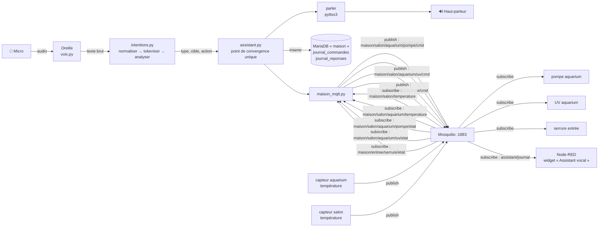
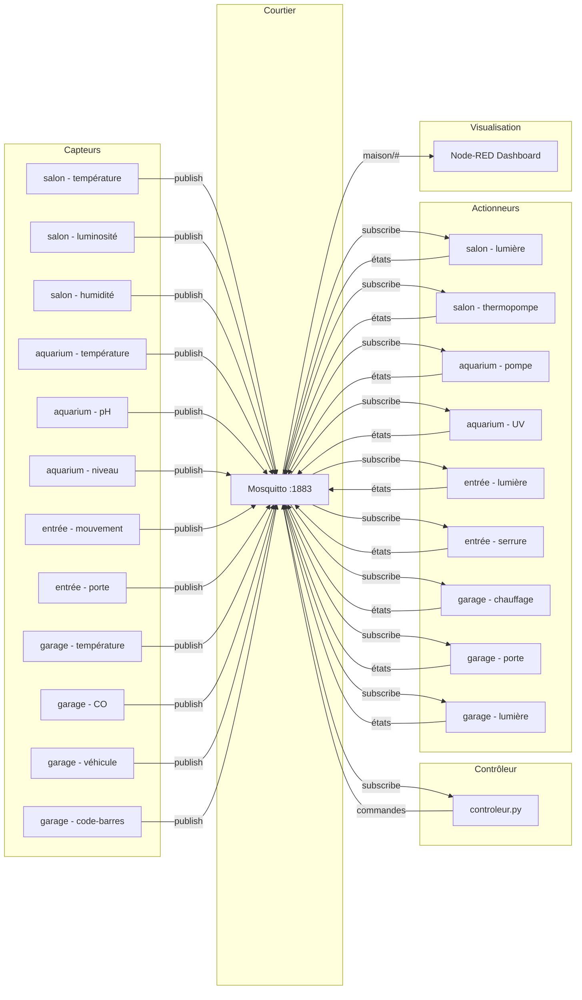

# Maison intelligente simulée + assistant vocal « Nestor »

Cours **420-315-AH — Développement d'objets intelligents**
Étudiante : **Laura Sorro** — Collège Ahuntsic, session été 2026

---

## Vue d'ensemble

Le dépôt contient deux couches successives d'un même système :

| | Contenu | Apport |
|---|---|---|
| **Projet 1** | Maison connectée simulée : 3 pièces (Salon, Entrée, Garage) + aquarium, 12 capteurs, 9 actionneurs, contrôleur à règles automatiques, tableau de bord Node-RED | Infrastructure MQTT |
| **Projet 2** | Assistant vocal francophone « Nestor » greffé sur cette infrastructure, et persistance MariaDB des lectures et des interactions | Voix + base de données |

Le Projet 2 est documenté en premier, car c'est la couche active. Le Projet 1 suit
comme référence technique de l'infrastructure sous-jacente.

---
---

# PROJET 2 — Assistant vocal « Nestor »

Nestor écoute au micro, reconnaît un mot-clé, analyse l'intention de la phrase,
commande les actionneurs réels via MQTT, répond à voix haute, et journalise chaque
interaction dans MariaDB ainsi que dans un tableau de bord Node-RED.

**Vidéo de démonstration (2-4 min) :** https://youtu.be/7C9RpHKh-IY

## 1. Architecture



> Seuls les capteurs et actionneurs **réellement utilisés par l'assistant** figurent
> sur ce diagramme. L'infrastructure complète est décrite dans la partie Projet 1.

**Note d'architecture — espaces de noms disjoints.** Le journal vocal publie sur
`assistant/journal`, hors de l'arbre `maison/`. Le tableau de bord comporte un nœud
abonné à `maison/#` pour la carte de la maison : si le journal vivait sous `maison/`,
le courtier livrerait chaque interaction **deux fois** au client Node-RED — une fois
par souscription correspondante — et chaque ligne apparaîtrait en double dans le
widget. Séparer les racines garantit à chaque flux un périmètre exclusif.

---

## 2. Grammaire des commandes vocales

### 2.1 Principe de l'analyse

`analyser()` ne fait pas de reconnaissance de phrase complète : elle cherche
**deux éléments indépendants** parmi les jetons, puis les combine.

| Éléments trouvés | Type retourné |
|---|---|
| un verbe d'action **et** un actionneur | `ACTION` |
| un capteur **et aucun** verbe d'action | `REQUETE` |
| tout autre cas | `INCONNUE` |

Conséquence : l'ordre des mots n'a aucune importance, et aucune formule
interrogative n'est nécessaire. « Nestor, le salon » suffit à obtenir la
température du salon ; « Nestor, quelle est la température ? » sans nom de pièce
retourne INCONNUE.

Le mot-clé peut être suivi directement de la commande, ou prononcé seul — Nestor
répond alors « Oui, je vous écoute » et attend la phrase pendant 5 secondes.

### 2.2 Le mot-clé : « Nestor »

Le mot-clé a été choisi **par mesure, pas par intuition**. Le banc d'essai
`test_mot_cle.py` fait prononcer chaque candidat cinq fois et compte les
transcriptions qui contiennent effectivement le mot après normalisation.

| Candidat | Score | Échec observé |
|---|---|---|
| **Nestor** | **5/5** | aucun |
| Athéna | 4/5 | « athén » — phrase tronquée, pas une erreur de modèle |
| Merlin | 4/5 | « Merlan » |
| Victor | 3/5 | « pita », et une capture vide |

**Pourquoi Merlin a été écarté.** « Merlan » est un nom commun français. Le modèle
de langue de Google privilégie systématiquement un nom commun fréquent sur un prénom
rare quand les deux sont phonétiquement identiques. L'échec n'était donc pas
accidentel : il se reproduisait, et aucun réglage du micro ne pouvait le corriger.
« Gandalf » avait été écarté plus tôt, pour une raison différente — anglicisme mal
rendu par la synthèse vocale française.

**Pourquoi Nestor.** Aucun homophone en nom commun, deux syllabes nettes, aucun mot
proche dans le vocabulaire domotique, et une prononciation correcte par pyttsx3 en
voix fr-CA. Les transcriptions erronées (« Bernard », « Berlin ») ne contiennent pas
le mot-clé : elles sont filtrées sans effet de bord.

> Les scores d'Athéna et de Victor ont été mesurés **avant** la correction de
> `dynamic_energy_threshold` (§ 5.4) : leurs échecs étaient des captures tronquées,
> pas des erreurs de reconnaissance. Celui de Merlin, lui, aurait persisté.

### 2.3 Verbes reconnus

Impératif **et** infinitif, pour accepter aussi bien « allume la pompe » que
« peux-tu allumer la pompe » (la formule de politesse est retirée, le verbe reste à
l'infinitif).

| Intention | Verbes |
|---|---|
| **ON** | allume, allumer, active, activer, demarre, demarrer, verrouille, verrouiller, barre, barrer |
| **OFF** | eteins, eteint, eteindre, ferme, fermer, arrete, arreter, desactive, desactiver, deverrouille, deverrouiller, debarre, debarrer |

Les verbes sont comparés **après normalisation**, donc sans accents : la table
ci-dessus reflète exactement le contenu de `VERBES_ON` et `VERBES_OFF`.

> **« ouvre » est volontairement exclu.** Appliqué à une serrure, le mot est ambigu
> (ouvrir la porte ≠ déverrouiller). L'ambiguïté produirait une action non voulue
> plutôt qu'un rejet propre. « ferme » reste dans `VERBES_OFF` car il sert aussi
> aux autres actionneurs — pour la serrure, « ferme la porte » est donc interprété
> comme un déverrouillage. Préférer « verrouille » et « déverrouille », qui ne
> souffrent d'aucune ambiguïté.

### 2.4 Cibles reconnues

**Actionneurs** — dictionnaire `ACTIONNEURS`, surnom → nom interne :

| Mots reconnus | Nom interne |
|---|---|
| pompe | `aquarium_pompe` |
| uv, sterilisateur | `aquarium_uv` |
| serrure, porte, verrou | `entree_serrure` |

**Capteurs** — dictionnaire `CAPTEURS`, mot de lieu → nom interne :

| Mot reconnu | Nom interne |
|---|---|
| aquarium | `temperature_aquarium` |
| salon | `temperature_salon` |

Le nom de la grandeur mesurée (« température ») n'est pas analysé : chaque lieu
n'expose qu'un seul capteur interrogeable, le mot de lieu suffit donc à lever
l'ambiguïté. Ajouter une deuxième grandeur par pièce demanderait d'étendre la
clé du dictionnaire.

### 2.5 Phrases-types

| Phrase prononcée | Type | Réponse de Nestor |
|---|---|---|
| Nestor, quelle est la température de l'aquarium ? | REQUETE | La température de l'aquarium est de 24.2 degrés Celsius. |
| Nestor, donne-moi la température du salon | REQUETE | Il fait 21.5 degrés Celsius dans le salon. |
| Nestor, éteins la pompe s'il te plaît | ACTION | J'éteins la pompe de l'aquarium. |
| Nestor, peux-tu allumer l'UV | ACTION | J'allume la lumière UV de l'aquarium. |
| Nestor, verrouille la porte | ACTION | Voulez-vous que je verrouille la serrure de l'entrée ? *(confirmation — § 2.8)* |
| Nestor, verrouille la porte *(déjà verrouillée)* | ACTION | La serrure de l'entrée est déjà verrouillée. *(aucun message MQTT — § 3.4)* |
| Nestor, déverrouille le verrou | ACTION | Voulez-vous que je déverrouille la serrure de l'entrée ? |
| Nestor, allume la pomme | INCONNUE | Désolé, je n'ai pas compris : allume la pomme. |

La phrase rejetée est **répétée** dans la réponse : c'est ce qui permet à
l'utilisateur de comprendre *pourquoi* sa commande a échoué. Les commandes reconnues
ne sont pas répétées — la réponse elle-même (« J'éteins la pompe de l'aquarium »)
nomme déjà l'action et sa cible.

> **Cas limite à connaître.** « Nestor, éteins la lumière du salon » est analysée
> comme une REQUETE ? Non : « eteins » est un verbe d'action, mais « lumiere » ne
> figure pas dans `ACTIONNEURS` — et bien que « salon » soit un capteur, la branche
> REQUETE exige l'absence de verbe d'action. Le résultat est donc INCONNUE, ce qui
> est le comportement voulu : la lumière du salon est pilotée par le contrôleur,
> pas par la voix.

### 2.6 Normalisation — l'ordre compte

`normaliser()` applique les transformations dans cet ordre strict :

| # | Étape | Effet |
|---|---|---|
| 1 | minuscules | « Nestor » ≡ « nestor » |
| 2 | décomposition NFD + retrait des diacritiques | « éteins » → « eteins » |
| 3 | apostrophes et tirets → espaces | « s'il » → « s il », « peux-tu » → « peux tu » |
| 4 | retrait des formules de politesse (regex `POLITESSE`) | « s il te plait » disparaît |
| 5 | ponctuation restante → espaces | tout ce qui n'est pas `[a-z0-9 ]` |
| 6 | espaces multiples → espace simple | |

**Inverser 3 et 4 casserait la regex.** `POLITESSE` est écrite sans accents ni
apostrophes (`s il te plait`, `peux tu`) précisément parce qu'elle s'applique après
les étapes 2 et 3. C'est le piège principal de cette fonction.

Formules retirées : bonjour, salut, merci, s'il te plaît, s'il vous plaît, stp, svp,
je voudrais, peux-tu, pouvez-vous.

La tokenisation utilise `nltk.word_tokenize(language="french")`. Le corpus
`punkt_tab` est téléchargé une seule fois, au premier import
(`try nltk.data.find` / `except nltk.download`).

> **Pourquoi les phrases journalisées sont sans accents.** C'est la phrase
> *normalisée* qui est enregistrée, car c'est elle que l'assistant a réellement
> analysée. Journaliser le texte brut donnerait une trace différente de ce qui a été
> traité, ce qui rendrait le débogage trompeur. `traiter_phrase()` appelle
> `normaliser()` **en entrée**, si bien que la trace est identique quel que soit le
> chemin suivi par la commande (§ 7).

### 2.7 Gestion des échecs de capture

Une capture peut échouer de trois façons, et chacune reçoit un message distinct.
**Aucun échec n'est silencieux.**

| Exception | Cause | Message | Réessai |
|---|---|---|---|
| `WaitTimeoutError` | aucun son avant la fin du `timeout` | « Je n'ai rien entendu. » | oui |
| `UnknownValueError` | son capté, transcription impossible | « Je n'ai pas compris. Pouvez-vous répéter ? » | oui |
| `RequestError` | service de reconnaissance injoignable | « Le service de reconnaissance est indisponible pour le moment. » | **non** |

**Pourquoi `RequestError` n'est pas réessayé.** Les deux premiers échecs viennent de
l'utilisateur ou de son environnement : répéter a une chance d'aboutir. Le troisième
vient du réseau. Réessayer trois fois un service tombé ferait attendre l'utilisateur
une quinzaine de secondes pour un résultat certain d'avance.

**Trois tentatives, puis abandon.** Après trois captures infructueuses, Nestor dit
« Je vous laisse. Rappelez-moi quand vous voulez » et retourne à la veille du
mot-clé. L'utilisateur n'est jamais bloqué dans une boucle.

**La fonction de capture ne parle jamais.** `_capter()` retourne le couple
`(texte, echec)` et c'est l'appelant qui décide du message. La veille du mot-clé
utilise `ecouter()`, qui jette la cause de l'échec : commenter chaque bruit ambiant
non compris rendrait l'assistant intenable.

> `_capter()` est la **seule** fonction du projet qui accède au micro. `ecouter()` et
> `ecouter_commande()` ne font que filtrer son résultat.

### 2.8 Confirmation avant action

Toute action n'a pas le même enjeu. Le principe retenu :

| Type de commande | Traitement | Justification |
|---|---|---|
| Requête d'état | exécutée directement | Une température lue n'a aucune conséquence |
| Action sur la pompe ou l'UV | exécutée directement | Réversible d'une phrase, aucun enjeu de sécurité |
| Action sur la serrure | **confirmation oui/non** | Seul actionneur touchant à la sécurité du domicile |

La confirmation accepte plusieurs formulations (`oui`, `ouais`, `confirme`, `vas-y` /
`non`, `annule`, `laisse`, `stop`). Une réponse hors-sujet déclenche une relance
« Répondez simplement par oui ou par non ». Après trois tentatives sans réponse
exploitable, Nestor dit « Dans le doute, je préfère ne rien faire » : **en cas
d'incertitude, l'inaction est le comportement sûr.**

Un refus laisse malgré tout une ligne dans `journal_commandes` : la commande a bien
été entendue et comprise, seule l'exécution n'a pas eu lieu. C'est consultable en
base.

> Confirmer *chaque* commande aurait doublé la durée de chaque échange sans
> bénéfice : c'est le dosage, pas la systématicité, qui rend la confirmation utile.

---

## 3. Sujets MQTT de l'assistant

### 3.1 Journal vocal (publish)

| Sujet | Charge utile | Description |
|---|---|---|
| `assistant/journal` | `{"phrase","type","reponse"}` | Une interaction complète : phrase normalisée, type d'intention, réponse vocale. Consommé par Node-RED. |

> Racine **volontairement distincte** de `maison/` — voir la note d'architecture (§1).

### 3.2 Capteurs lus (subscribe)

| Sujet | Nom interne | Usage |
|---|---|---|
| `maison/salon/aquarium/temperature` | `temperature_aquarium` | Requête d'état n° 1 |
| `maison/salon/temperature` | `temperature_salon` | Requête d'état n° 2 |

L'assistant conserve la dernière valeur reçue en mémoire (`dernieres_valeurs`) : il
ne consulte jamais la base pour répondre. Tant qu'aucune lecture n'est arrivée, il
répond « Je n'ai pas encore reçu de lecture pour ce capteur ».

### 3.3 Actionneurs commandés (publish)

| Sujet de commande | Nom interne | ON | OFF |
|---|---|---|---|
| `maison/salon/aquarium/pompe/cmd` | `aquarium_pompe` | `allume` | `eteint` |
| `maison/salon/aquarium/uv/cmd` | `aquarium_uv` | `allume` | `eteint` |
| `maison/entree/serrure/cmd` | `entree_serrure` | `verrouille` | `deverrouille` |

Charge utile : `{"commande": "..."}` — **format identique à celui du contrôleur du
Projet 1**. Les actionneurs ne font aucune différence entre une commande automatique
et une commande vocale.

La table de correspondance `COMMANDES` (attribut de classe de `MaisonMQTT`) traduit
l'intention abstraite ON/OFF en vocabulaire propre à chaque appareil : la serrure
parle « verrouille/deverrouille », les autres « allume/eteint ».

> **Choix du trio « zéro conflit ».** Aucun de ces trois actionneurs n'est piloté par
> une règle automatique du contrôleur (voir le tableau des règles du Projet 1).
> Pendant la démonstration, le contrôleur ne peut donc pas annuler une commande
> vocale — contrairement à la lumière du salon, que la règle de luminosité
> rallumerait aussitôt. Ce sont aussi des objets **uniques** dans la maison : aucune
> ambiguïté de pièce à lever dans la phrase.

### 3.4 États des actionneurs (subscribe)

| Sujet | Nom interne |
|---|---|
| `maison/salon/aquarium/pompe/etat` | `aquarium_pompe` |
| `maison/salon/aquarium/uv/etat` | `aquarium_uv` |
| `maison/entree/serrure/etat` | `entree_serrure` |

Ces sujets sont publiés par les actionneurs avec `retain=True` (choix du Projet 1,
§ Bonus #4). Conséquence directe : **le courtier livre l'état courant dès la
connexion de l'assistant**, sans attendre le prochain changement. Nestor connaît donc
l'état de ses trois actionneurs avant même la première commande.

`deja_dans_etat(appareil, action)` compare l'état reçu à la commande que l'action
produirait. Si les deux coïncident, Nestor répond par un constat (« La serrure de
l'entrée est déjà verrouillée »), **ne publie aucun message MQTT**, et ne demande pas
de confirmation — confirmer une action sans effet n'aurait aucun sens.

**Si l'état est inconnu, la commande est envoyée.** Un actionneur qui n'a jamais
publié laisse `deja_dans_etat()` retourner `False`. Refuser d'agir par ignorance
serait pire qu'envoyer une commande redondante — que l'actionneur absorbe de toute
façon sans changer d'état.

> Cette vérification est un **confort d'usage, pas une protection** :
> `base_actionneur.py` gère déjà l'idempotence de son côté (une commande identique à
> l'état courant ne produit aucune transition).

---

## 4. Base de données

### 4.1 Schéma

Base `maison`, **14 tables** créées automatiquement au premier appel :
12 tables de lectures de capteurs (une par entrée de `config.TABLES_CAPTEURS`,
alimentées par le contrôleur) et 2 tables de journalisation vocale.

**`journal_commandes`** — ce que Nestor a *entendu et compris*

| Colonne | Type | Nullable | Justification |
|---|---|---|---|
| `id` | `INT AUTO_INCREMENT PRIMARY KEY` | non | Clé primaire |
| `phrase` | `VARCHAR(255) NOT NULL` | non | Phrase normalisée, telle qu'analysée |
| `type_intention` | `VARCHAR(16) NOT NULL` | non | `ACTION`, `REQUETE` ou `INCONNUE` |
| `cible` | `VARCHAR(64)` | **oui** | NULL pour une INCONNUE : aucune cible identifiée |
| `action` | `VARCHAR(8)` | **oui** | NULL pour une REQUETE ou une INCONNUE : seules les ACTIONs portent ON/OFF |
| `horodatage` | `DATETIME NOT NULL DEFAULT CURRENT_TIMESTAMP` | non | Rempli par le SGBD |

**`journal_reponses`** — ce que Nestor a *dit*

| Colonne | Type | Nullable | Justification |
|---|---|---|---|
| `id` | `INT AUTO_INCREMENT PRIMARY KEY` | non | Clé primaire |
| `texte` | `VARCHAR(255) NOT NULL` | non | Réponse vocale exacte |
| `horodatage` | `DATETIME NOT NULL DEFAULT CURRENT_TIMESTAMP` | non | Rempli par le SGBD |

**`lectures_*`** (× 12) — structure commune à tous les capteurs

| Colonne | Type | Justification |
|---|---|---|
| `id` | `INT AUTO_INCREMENT PRIMARY KEY` | Clé primaire |
| `valeur` | `DOUBLE NOT NULL` | Accepte entiers et décimaux sans distinction |
| `unite` | `VARCHAR(16) NOT NULL DEFAULT ''` | °C, lux, %, ppm — rend la lecture autoportante |
| `horodatage` | `DATETIME NOT NULL DEFAULT CURRENT_TIMESTAMP` | Rempli par le SGBD |

### 4.2 Décisions de conception

**Une table par capteur plutôt qu'une table unique.** Chaque capteur a son propre
type de valeur et sa propre cadence ; les séparer évite une colonne `capteur` répétée
sur des millions de lignes et permet de purger un historique sans toucher aux autres.
La correspondance capteur → table est centralisée dans `config.TABLES_CAPTEURS`.

**Deux tables de journal plutôt qu'une.** Une commande et une réponse sont deux
événements distincts : toute commande est journalisée, y compris rejetée, alors
qu'une réponse existe même sans commande valide. Les séparer évite des colonnes
majoritairement NULL et permet d'interroger l'un sans l'autre.

**`cible` et `action` NULL-ables.** C'est ce qui rend traçables les échecs de
compréhension. Une intention INCONNUE laisse une ligne complète avec la phrase
exacte — matière première pour enrichir `ACTIONNEURS` et `CAPTEURS`.

**Horodatage côté SGBD.** `DEFAULT CURRENT_TIMESTAMP` plutôt qu'un `datetime.now()`
Python : une seule source de vérité temporelle, insensible aux écarts d'horloge entre
les processus (contrôleur et assistant tournent séparément).

**Une seule fonction d'insertion.** `inserer(table, valeurs)` construit la requête à
partir des clés du dictionnaire et passe les valeurs en **paramètres liés** (`?`) —
aucune valeur n'est concaténée dans une chaîne SQL. Aucune requête `INSERT` n'est
écrite deux fois dans le projet.

**Connexion paresseuse.** `_obtenir_connexion()` n'ouvre la connexion qu'au premier
appel réel : un module importé sans être utilisé ne mobilise pas MariaDB. La création
de la base et des tables (`CREATE ... IF NOT EXISTS`) se fait au même moment, ce qui
rend le projet installable sans script SQL préalable.

**`autocommit=True`.** Chaque insertion est indépendante : il n'existe aucune
opération multi-tables à rendre atomique, donc pas de transaction explicite à gérer.

**Une instance par programme.** Le contrôleur et l'assistant créent chacun leur
`BaseDeDonnees`, donc leur propre connexion — aucun objet partagé entre processus.

---

## 5. Installation (Projet 2)

### 5.1 Prérequis supplémentaires

En plus de Mosquitto et Node-RED (voir Projet 1) :

- **Python 3.13** — *pas 3.14* : PyAudio n'a pas de binaire précompilé pour 3.14 (échec sur `portaudio.h`). Toutes les commandes utilisent `py -3.13`.
- **MariaDB** sur `localhost:3306`
- Un microphone fonctionnel

### 5.2 Dépendances

```powershell
py -3.13 -m pip install -r requirements.txt
```

Deux versions sont épinglées pour des raisons précises :

| Paquet | Version | Raison |
|---|---|---|
| `pyttsx3` | 2.71 | Les versions ultérieures ne relisent plus après le premier `runAndWait()` (bug du pilote SAPI5) |
| `python-dotenv` | 1.0.1 | Lecture du fichier `.env` |

### 5.3 Identifiants de la base

Le mot de passe n'est **pas** dans le code. Copier le modèle et le renseigner :

```powershell
copy .env.exemple .env
```

Puis éditer `.env` :

```
DB_PASSWORD=votre_mot_de_passe_mariadb
```

`config.py` le lit via `os.getenv()` et lève une erreur explicite si la variable est
absente. Le fichier `.env` est ignoré par Git.

### 5.4 Voix de synthèse et réglages d'écoute

`voix.py` cible la voix **Microsoft Claude (fr-CA)**, avec repli automatique sur la
première voix française disponible si elle est absente du système. Le moteur pyttsx3
est initialisé **une seule fois** au niveau du module (`init()` prend environ une
seconde).

Trois réglages du `Recognizer`, chacun pour une raison précise :

| Réglage | Valeur | Raison |
|---|---|---|
| `pause_threshold` | 1,5 s | Le défaut (0,8 s) coupait les phrases sur les pauses naturelles |
| `dynamic_energy_threshold` | `False` | Le seuil se réajustait **pendant** la phrase et coupait la fin quand la voix baissait (« éteins la pompe s'il… ») |
| `adjust_for_ambient_noise` | 2 s | Calibration plus fiable, puisque le seuil est ensuite figé |

Durées d'écoute : `timeout=5 s` (délai avant le premier son) et
`phrase_time_limit=8 s` (durée maximale d'une phrase). Mesurées sur les phrases-types
du § 2.5, dont la plus longue — « Nestor, quelle température fait-il dans le salon ? » — dure 2,98 secondes.

---

## 6. Exécution (Projet 2)

Un terminal par commande, depuis la racine du projet.

```powershell
# Terminal 1 — contrôleur + journalisation MariaDB des capteurs
py -3.13 -m controleur.controleur

# Terminaux 2-3 — les deux capteurs interrogeables
py -3.13 -m capteurs.capteur_aquarium_temperature
py -3.13 -m capteurs.capteur_salon_temperature

# Terminaux 4-6 — les trois actionneurs commandables
py -3.13 -m actionneurs.actionneur_aquarium_pompe
py -3.13 -m actionneurs.actionneur_aquarium_uv
py -3.13 -m actionneurs.actionneur_entree_serrure

# Terminal 7 — Nestor
py -3.13 -m assistant.assistant
```

Laisser les capteurs publier deux ou trois secondes avant de parler.

### Banc d'essai de l'analyse d'intentions

Sans micro ni courtier :

```powershell
py -3.13 test_intentions.py
```

6 phrases, 6 analyses attendues : 3 ACTION, 2 REQUETE, 1 INCONNUE.

### Banc d'essai du mot-clé

Avec micro, sans courtier ni base :

```powershell
py -3.13 test_mot_cle.py
```

Chaque candidat est prononcé 5 fois ; le script compte les transcriptions contenant
le mot après normalisation. Résultats : § 2.2.

### Tableau de bord

Deux pages :

- **Démo** — le groupe *Assistant vocal* (journal des 15 dernières interactions), les deux capteurs interrogeables et les trois actionneurs commandables. C'est la page utilisée pour la démonstration : elle ne montre que ce qui est actif.
- **Maison** — l'infrastructure complète du Projet 1.

> L'historique du journal vocal est conservé dans le contexte de flux Node-RED : il
> est vidé à chaque `Deploy` et à chaque redémarrage. C'est voulu — la liste se
> remplit en direct pendant la démonstration.

---

## 7. Débogage

L'assistant imprime en continu ce qu'il **entend** et ce qu'il **répond** :

```
Entendu : Nestor quelle est la temperature de l aquarium
Assistant : La température de l'aquarium est de 23.09 degrés Celsius.
```

Les phrases sans mot-clé apparaissent aussi (`Entendu :` sans `Assistant :`) : c'est
ce qui rend visible le filtrage du mot-clé.

**Les phrases journalisées sont normalisées, quel que soit le chemin.**
`traiter_phrase()` appelle `normaliser()` en entrée : que la commande ait suivi le
mot-clé dans la même phrase ou qu'elle ait été captée séparément, c'est exactement le
texte analysé qui est enregistré. Journaliser le texte brut dans un cas et normalisé
dans l'autre rendrait le débogage trompeur.

Vérifier la journalisation en base :

```sql
SELECT * FROM maison.journal_commandes ORDER BY horodatage DESC LIMIT 10;
SELECT * FROM maison.journal_reponses  ORDER BY horodatage DESC LIMIT 10;
```

---

## 8. Bugs du squelette trouvés et corrigés

| Fichier | Problème | Correction |
|---|---|---|
| `config.py` | `DB_PORT` absent alors que `db.py` l'utilise | Ajout de `DB_PORT = 3306` |
| `assistant/assistant.py` | Variable `appareil` inexistante dans `executer_intention()` | Renommée `actionneur` |
| `assistant/maison_mqtt.py` | `on_connect` à 4 paramètres, incompatible avec `CallbackAPIVersion.VERSION2` | Signature portée à 5 paramètres (`reason_code`, `properties`) |
| `assistant/assistant.py` | `self.arreter()` appelé hors de la classe, en fin de fichier | Ligne supprimée — `main()` appelle déjà `self.arreter()` |

---

## 9. Évolutions possibles

**Consigne de température (setpoint).** Piloter la thermopompe à la voix (« mets 22
degrés ») demanderait plus qu'une commande supplémentaire. Les règles 3 à 5 du
contrôleur comparent la température à des seuils codés en dur et republient leur
décision toutes les deux secondes : une commande vocale serait écrasée dans la
seconde. Il faudrait introduire un sujet de consigne, que le contrôleur lirait à la
place de ses seuils, et gérer sa persistance. C'est un changement d'architecture du
contrôleur, pas un ajout à l'assistant — raison pour laquelle la thermopompe est
restée hors du périmètre vocal (voir aussi le choix du trio « zéro conflit », § 3.3).

**Deuxième grandeur par pièce.** Les capteurs sont identifiés par leur seul mot de
lieu (§ 2.4). Ajouter l'humidité du salon obligerait à analyser aussi le nom de la
grandeur, donc à étendre la clé du dictionnaire `CAPTEURS`.

**Persistance de l'historique Node-RED.** Le journal vocal du tableau de bord vit
dans le contexte de flux, vidé à chaque `Deploy`. Le lire depuis `journal_commandes`
plutôt que depuis la mémoire de flux le rendrait permanent.

---
---

# PROJET 1 — Infrastructure MQTT

Simulation d'une maison connectée avec 3 pièces (Salon, Entrée, Garage) et un
aquarium : 12 capteurs, 9 actionneurs, un contrôleur à règles automatiques, et un
tableau de bord Node-RED en temps réel.

## Architecture complète (flux publish-subscribe)



---

## Règles d'automatisation

Le contrôleur relie capteurs et actionneurs via les règles suivantes :

| # | Capteur déclencheur | Condition | Actionneur | Commande |
|---|---------------------|-----------|------------|----------|
| 1 | Luminosité salon | < 200 lux | Lumière salon | `allume` |
| 2 | Luminosité salon | ≥ 200 lux | Lumière salon | `eteint` |
| 3 | Température salon | < 18°C | Thermopompe salon | `chauffe` |
| 4 | Température salon | > 23°C | Thermopompe salon | `climatise` |
| 5 | Température salon | 18–23°C | Thermopompe salon | `arrete` |
| 6 | pH aquarium | < 6.8 ou > 7.5 | — | log surveillance |
| 7 | Niveau aquarium | < 70% | UV aquarium | `eteint` |
| 8 | Niveau aquarium | ≥ 70% | UV aquarium | `allume` |
| 9 | Mouvement entrée | détecté (1) | Lumière entrée | `allume` |
| 10 | Mouvement entrée | absent (0) | Lumière entrée | `eteint` |
| 11 | Température garage | < 15°C | Chauffage garage | `allume` |
| 12 | Température garage | ≥ 17°C | Chauffage garage | `eteint` |
| 13 | CO garage | > 25 ppm | Porte garage | `ouvre` |
| 14 | Véhicule + code-barres valide | AUTO-001/002/003 | Porte + lumière garage | `ouvre` / `allume` |
| 15 | Véhicule parti | absent (0) | Porte + lumière garage | `ferme` / `eteint` |

**Notes sur les seuils :**
- Température garage : 15°C minimum selon le Règlement 03-096 de la Ville de Montréal
- CO garage : 25 ppm selon le Ministère de la Sécurité publique du Québec
- pH aquarium : 6.8–7.5 selon les normes d'aquariophilie eau douce

> **Lien avec le Projet 2.** La pompe et la serrure n'apparaissent dans aucune de
> ces règles ; l'UV n'y figure que via la règle de niveau d'eau (7-8), qui ne se
> déclenche pas tant que le capteur de niveau n'est pas lancé. C'est ce qui garantit
> l'absence de conflit pendant la démonstration vocale.

---

## Installation de l'infrastructure

**1. Mosquitto**
- Télécharger : https://mosquitto.org/download/
- Éditer `C:\Program Files\mosquitto\mosquitto.conf` :
```
  listener 1883 localhost
  allow_anonymous true
```
- Dans un terminal **administrateur** :
```powershell
  net stop mosquitto
  net start mosquitto
```

**2. Node-RED**
- Installer **Node.js LTS** : https://nodejs.org/
```powershell
  npm install -g node-red
  node-red
```
- Ouvrir http://localhost:1880
- Importer `flows.json` : menu ☰ → **Import** → sélectionner `flows.json` → **Deploy**
- Tableau de bord : http://localhost:1880/dashboard

---

## Exécution complète (les 22 processus)

> Pour la démonstration du Projet 2, seuls 7 terminaux sont nécessaires — voir la
> section 6 plus haut.

```powershell
# Contrôleur
py -3.13 -m controleur.controleur

# Capteurs (un terminal par capteur)
py -3.13 -m capteurs.capteur_salon_temperature
py -3.13 -m capteurs.capteur_salon_luminosite
py -3.13 -m capteurs.capteur_salon_humidite
py -3.13 -m capteurs.capteur_aquarium_temperature
py -3.13 -m capteurs.capteur_aquarium_ph
py -3.13 -m capteurs.capteur_aquarium_niveau
py -3.13 -m capteurs.capteur_entree_mouvement
py -3.13 -m capteurs.capteur_entree_porte
py -3.13 -m capteurs.capteur_garage_temperature
py -3.13 -m capteurs.capteur_garage_co
py -3.13 -m capteurs.capteur_garage_vehicule
py -3.13 -m capteurs.capteur_garage_barcode

# Actionneurs (un terminal par actionneur)
py -3.13 -m actionneurs.actionneur_salon_lumiere
py -3.13 -m actionneurs.actionneur_salon_thermopompe
py -3.13 -m actionneurs.actionneur_aquarium_pompe
py -3.13 -m actionneurs.actionneur_aquarium_uv
py -3.13 -m actionneurs.actionneur_entree_lumiere
py -3.13 -m actionneurs.actionneur_entree_serrure
py -3.13 -m actionneurs.actionneur_garage_chauffage
py -3.13 -m actionneurs.actionneur_garage_porte
py -3.13 -m actionneurs.actionneur_garage_lumiere
```

---

## Sujets MQTT complets

### Capteurs (publish)

| Sujet | Charge utile | Description |
|-------|-------------|-------------|
| `maison/salon/temperature` | `{"type","valeur","unite","horodatage"}` | Température salon (°C) |
| `maison/salon/luminosite` | `{"type","valeur","unite","horodatage"}` | Luminosité salon (lux) |
| `maison/salon/humidite` | `{"type","valeur","unite","horodatage"}` | Humidité salon (%) |
| `maison/salon/aquarium/temperature` | `{"type","valeur","unite","horodatage"}` | Température aquarium (°C) |
| `maison/salon/aquarium/ph` | `{"type","valeur","unite","horodatage"}` | pH aquarium (6.8–7.5 normal) |
| `maison/salon/aquarium/niveau` | `{"type","valeur","unite","horodatage"}` | Niveau eau aquarium (%) |
| `maison/entree/mouvement` | `{"type","valeur","unite","horodatage"}` | Mouvement entrée (0/1) |
| `maison/entree/porte` | `{"type","valeur","unite","horodatage"}` | État porte entrée (ouvert/ferme) |
| `maison/garage/temperature` | `{"type","valeur","unite","horodatage"}` | Température garage (°C) |
| `maison/garage/co` | `{"type","valeur","unite","horodatage"}` | CO garage (ppm) |
| `maison/garage/vehicule` | `{"type","valeur","unite","horodatage"}` | Présence véhicule (0/1) |
| `maison/garage/barcode` | `{"type","valeur","unite","horodatage"}` | Code-barres lu (AUTO-001/002/003/INCONNU) |

### Actionneurs (commande / état)

| Sujet commande | Sujet état | Commandes |
|----------------|------------|-----------|
| `maison/salon/lumiere/cmd` | `maison/salon/lumiere/etat` | `allume` / `eteint` |
| `maison/salon/thermopompe/cmd` | `maison/salon/thermopompe/etat` | `chauffe` / `climatise` / `ventile` / `arrete` |
| `maison/salon/aquarium/pompe/cmd` | `maison/salon/aquarium/pompe/etat` | `allume` / `eteint` |
| `maison/salon/aquarium/uv/cmd` | `maison/salon/aquarium/uv/etat` | `allume` / `eteint` |
| `maison/entree/lumiere/cmd` | `maison/entree/lumiere/etat` | `allume` / `eteint` |
| `maison/entree/serrure/cmd` | `maison/entree/serrure/etat` | `verrouille` / `deverrouille` |
| `maison/garage/chauffage/cmd` | `maison/garage/chauffage/etat` | `allume` / `eteint` |
| `maison/garage/porte/cmd` | `maison/garage/porte/etat` | `ouvre` / `ferme` |
| `maison/garage/lumiere/cmd` | `maison/garage/lumiere/etat` | `allume` / `eteint` |

### Santé des capteurs (LWT)

Chaque capteur publie `{"etat":"hors-ligne"}` sur son sujet `/sante` en cas de
déconnexion brutale :

`maison/salon/temperature/sante`, `maison/salon/luminosite/sante`,
`maison/salon/humidite/sante`, `maison/salon/aquarium/temperature/sante`,
`maison/salon/aquarium/ph/sante`, `maison/salon/aquarium/niveau/sante`,
`maison/entree/mouvement/sante`, `maison/entree/porte/sante`,
`maison/garage/temperature/sante`, `maison/garage/co/sante`,
`maison/garage/vehicule/sante`, `maison/garage/barcode/sante`

---

## Bonus

### #2 — Carte maison en temps réel (+5%)

Une deuxième page Node-RED affiche un plan de la maison en HTML/CSS. La couleur de la
bordure change selon l'état : 🟢 normal, 🟡 attention (thermopompe active), 🔴 alerte
(mouvement détecté). Les données proviennent d'un abonnement `maison/#` via un nœud
`function` qui maintient l'état global en mémoire de flux.

### #4 — Robustesse MQTT (+5%)

- **QoS 0** pour les capteurs : publication fréquente (2 s), une valeur perdue est sans conséquence
- **QoS 2** pour les abonnements des actionneurs : une commande doit être exécutée exactement une fois
- **retain=True** sur tous les sujets capteurs et états actionneurs : le tableau de bord affiche une valeur dès l'ouverture — et l'assistant vocal connaît l'état de ses actionneurs dès sa connexion (§ 3.4)
- **LWT** sur chaque capteur : en cas de déconnexion brutale, le courtier publie automatiquement `{"etat":"hors-ligne"}` sur le sujet `/sante`

### Bonus retirés

**#1 — Capteur de vision OpenCV :** la bibliothèque ne permettait pas d'afficher le
flux vidéo dans le tableau de bord Node-RED. Sans visualisation, la valeur ajoutée par
rapport à un capteur simulé était insuffisante.

**#3 — Alertes et notifications :** les données étant simulées aléatoirement, les
alertes se déclenchaient continuellement sans refléter une situation réelle. La
persistance MariaDB du Projet 2 rend désormais ce type d'analyse pertinent.

---
---

## Structure du dépôt

```
projet1-420-315-E26/
├── .env                                Secrets locaux — NON versionné
├── .env.exemple                        Modèle à copier
├── .gitignore
├── config.py                           Constantes : MQTT, BD, sujets, tables
├── requirements.txt
├── flows.json                          Flux Node-RED exportés
├── test_intentions.py                  Banc d'essai de l'analyse
├── test_mot_cle.py                     Banc d'essai des mots-clés candidats
├── assistant/                          ── PROJET 2 ──
│   ├── __init__.py
│   ├── assistant.py                    Boucle principale, mot-clé, tentatives, confirmation, journalisation
│   ├── intentions.py                   normaliser / tokeniser / analyser
│   ├── maison_mqtt.py                  commander, lire, deja_dans_etat, publier_interaction
│   └── voix.py                         Oreille (_capter / ecouter / ecouter_commande) + parler
├── basededonnees/                      ── PROJET 2 ──
│   ├── __init__.py
│   └── db.py                           Connexion paresseuse + inserer()
├── capteurs/                           ── PROJET 1 ──
│   ├── __init__.py
│   ├── base_capteur.py                 Classe de base Capteur (LWT, retain, QoS)
│   ├── capteur_salon_temperature.py
│   ├── capteur_salon_luminosite.py
│   ├── capteur_salon_humidite.py
│   ├── capteur_aquarium_temperature.py
│   ├── capteur_aquarium_ph.py          Capteur pH (ajouté par la prof)
│   ├── capteur_aquarium_niveau.py
│   ├── capteur_entree_mouvement.py
│   ├── capteur_entree_porte.py
│   ├── capteur_garage_temperature.py
│   ├── capteur_garage_co.py            Détection monoxyde de carbone
│   ├── capteur_garage_vehicule.py
│   ├── capteur_garage_barcode.py       Lecteur de code-barres simulé
│   └── exemples/
│       └── capteur_aquarium.py         Exemple fourni par la prof
├── actionneurs/                        ── PROJET 1 ──
│   ├── __init__.py
│   ├── base_actionneur.py              Classe de base Actionneur (QoS 2, retain)
│   ├── actionneur_salon_lumiere.py
│   ├── actionneur_salon_thermopompe.py
│   ├── actionneur_aquarium_pompe.py
│   ├── actionneur_aquarium_uv.py
│   ├── actionneur_entree_lumiere.py
│   ├── actionneur_entree_serrure.py    Verrouillée par défaut
│   ├── actionneur_garage_chauffage.py
│   ├── actionneur_garage_porte.py
│   └── actionneur_garage_lumiere.py
└── controleur/
    ├── __init__.py
    └── controleur.py                   Règles d'automatisation + journalisation MariaDB
```

---

*Projet réalisé dans le cadre du cours 420-315-AH — Collège Ahuntsic, session été 2026.*