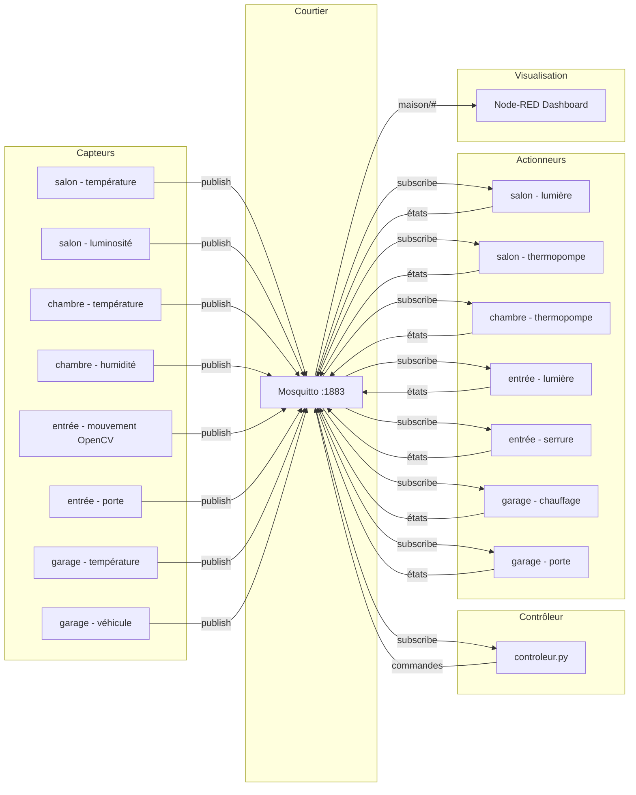

# Projet 1 — Maison intelligente simulée

Cours **420-315-AH — Développement d'objets intelligents**  
Étudiante : **Laura Sorro**

Simulation d'une maison connectée avec 4 pièces (Salon, Chambre, Entrée, Garage), 8 capteurs, 7 actionneurs, un contrôleur à règles automatiques, et un tableau de bord Node-RED en temps réel.

---

## Architecture (flux publish-subscribe)



---

## Règles d'automatisation

Le contrôleur relie capteurs et actionneurs via 15 règles :

| # | Capteur déclencheur | Condition | Actionneur | Commande |
|---|---------------------|-----------|------------|----------|
| 1 | Luminosité salon | < 200 lux | Lumière salon | `allume` |
| 2 | Luminosité salon | ≥ 200 lux | Lumière salon | `eteint` |
| 3 | Température salon | < 18°C | Thermopompe salon | `chauffe` |
| 4 | Température salon | > 23°C | Thermopompe salon | `climatise` |
| 5 | Température salon | 18–23°C | Thermopompe salon | `arrete` |
| 6 | Température chambre | < 16°C | Thermopompe chambre | `chauffe` |
| 7 | Température chambre | > 23°C | Thermopompe chambre | `climatise` |
| 8 | Température chambre | 16–23°C | Thermopompe chambre | `arrete` |
| 9 | Mouvement entrée | détecté (1) | Lumière entrée | `allume` |
| 10 | Mouvement entrée | absent (0) | Lumière entrée | `eteint` |
| 11 | Mouvement entrée | détecté (1) | Serrure entrée | `verrouille` |
| 12 | Mouvement entrée | absent (0) | Serrure entrée | `deverrouille` |
| 13 | Température garage | < 5°C | Chauffage garage | `allume` |
| 14 | Température garage | ≥ 7°C | Chauffage garage | `eteint` |
| 15 | Véhicule garage | détecté (1) | Porte garage | `ouvre` |

---

## Structure

```
projet1-420-315-E26/
├── config.py                     Constantes : MQTT, sujets, tables
├── requirements.txt
├── flows.json                    Flux Node-RED exportés
├── capteurs/
│   ├── __init__.py
│   ├── base_capteur.py           Classe de base Capteur (LWT, retain, QoS)
│   ├── capteur_salon_temperature.py
│   ├── capteur_salon_luminosite.py
│   ├── capteur_chambre_temperature.py
│   ├── capteur_chambre_humidite.py
│   ├── capteur_entree_mouvement.py   Détection mouvement OpenCV (bonus)
│   ├── capteur_entree_porte.py
│   ├── capteur_garage_temperature.py
│   ├── capteur_garage_vehicule.py
│   └── exemples/
│       └── capteur_aquarium.py   Exemple fourni par la prof
├── actionneurs/
│   ├── __init__.py
│   ├── base_actionneur.py        Classe de base Actionneur (QoS 2, retain)
│   ├── actionneur_salon_lumiere.py
│   ├── actionneur_salon_thermopompe.py
│   ├── actionneur_chambre_thermopompe.py
│   ├── actionneur_entree_lumiere.py
│   ├── actionneur_entree_serrure.py
│   ├── actionneur_garage_chauffage.py
│   ├── actionneur_garage_porte.py
│   └── exemples/
│       └── actionneur_aquarium.py    Exemple fourni par la prof
└── controleur/
    ├── __init__.py
    └── controleur.py             Contrôleur + règles + alertes
```

---

## Prérequis

- **Python 3.11+**
- **Mosquitto** (courtier MQTT) en écoute sur `localhost:1883`
- **Node-RED** + le module **@flowfuse/node-red-dashboard**
- **OpenCV** pour le capteur de mouvement (bonus)

### Windows 10/11

**1. Mosquitto**
- Télécharger : https://mosquitto.org/download/
- Éditer `C:\Program Files\mosquitto\mosquitto.conf` :
```
  listener 1883 localhost
  allow_anonymous true
```
- Dans un terminal **administrateur** :
```powershell
  net stop mosquitto
  net start mosquitto
```

**2. Node-RED**
- Installer **Node.js LTS** : https://nodejs.org/
```powershell
  npm install -g node-red
  node-red
```

**3. Dépendances Python**
```powershell
  py -m pip install paho-mqtt opencv-python
```

---

## Exécution

> Lancer chaque commande dans un terminal séparé, depuis le dossier `projet1-420-315-E26/`.

```powershell
# Terminal 1 — Contrôleur
py -m controleur.controleur

# Capteurs (un terminal par capteur)
py -m capteurs.capteur_salon_temperature
py -m capteurs.capteur_salon_luminosite
py -m capteurs.capteur_chambre_temperature
py -m capteurs.capteur_chambre_humidite
py -m capteurs.capteur_entree_mouvement
py -m capteurs.capteur_entree_porte
py -m capteurs.capteur_garage_temperature
py -m capteurs.capteur_garage_vehicule

# Actionneurs (un terminal par actionneur)
py -m actionneurs.actionneur_salon_lumiere
py -m actionneurs.actionneur_salon_thermopompe
py -m actionneurs.actionneur_chambre_thermopompe
py -m actionneurs.actionneur_entree_lumiere
py -m actionneurs.actionneur_entree_serrure
py -m actionneurs.actionneur_garage_chauffage
py -m actionneurs.actionneur_garage_porte
```

### Tableau de bord Node-RED

1. Lancer Node-RED : `node-red`
2. Ouvrir http://localhost:1880
3. Importer `flows.json` : menu ☰ → **Import** → sélectionner `flows.json`
4. Cliquer **Deploy**
5. Tableau de bord : http://localhost:1880/dashboard

---

## Sujets MQTT

### Capteurs (publish)

| Sujet | Charge utile | Description |
|-------|-------------|-------------|
| `maison/salon/temperature` | `{"type","valeur","unite","horodatage"}` | Température salon (°C) |
| `maison/salon/luminosite` | `{"type","valeur","unite","horodatage"}` | Luminosité salon (lux) |
| `maison/chambre/temperature` | `{"type","valeur","unite","horodatage"}` | Température chambre (°C) |
| `maison/chambre/humidite` | `{"type","valeur","unite","horodatage"}` | Humidité chambre (%) |
| `maison/entree/mouvement` | `{"type","valeur","unite","horodatage"}` | Mouvement entrée — OpenCV (0/1) |
| `maison/entree/porte` | `{"type","valeur","unite","horodatage"}` | État porte entrée (ouvert/ferme) |
| `maison/garage/temperature` | `{"type","valeur","unite","horodatage"}` | Température garage (°C) |
| `maison/garage/vehicule` | `{"type","valeur","unite","horodatage"}` | Présence véhicule (0/1) |

### Actionneurs (commande / état)

| Sujet commande | Sujet état | Commandes |
|----------------|------------|-----------|
| `maison/salon/lumiere/cmd` | `maison/salon/lumiere/etat` | `allume` / `eteint` |
| `maison/salon/thermopompe/cmd` | `maison/salon/thermopompe/etat` | `chauffe` / `climatise` / `ventile` / `arrete` |
| `maison/chambre/thermopompe/cmd` | `maison/chambre/thermopompe/etat` | `chauffe` / `climatise` / `ventile` / `arrete` |
| `maison/entree/lumiere/cmd` | `maison/entree/lumiere/etat` | `allume` / `eteint` |
| `maison/entree/serrure/cmd` | `maison/entree/serrure/etat` | `verrouille` / `deverrouille` |
| `maison/garage/chauffage/cmd` | `maison/garage/chauffage/etat` | `allume` / `eteint` |
| `maison/garage/porte/cmd` | `maison/garage/porte/etat` | `ouvre` / `ferme` |

### Alertes

| Sujet | Charge utile | Déclencheur |
|-------|-------------|-------------|
| `maison/alertes` | `{"alerte","horodatage"}` | Mouvement nocturne (23h–5h) |
| `maison/alertes` | `{"alerte","horodatage"}` | Température salon hors plage |
| `maison/alertes` | `{"alerte","horodatage"}` | Porte entrée ouverte > 30s |
| `maison/alertes` | `{"alerte","horodatage"}` | Véhicule détecté dans le garage |

### Santé des capteurs (LWT)

| Sujet | Charge utile | Description |
|-------|-------------|-------------|
| `maison/salon/temperature/sante` | `{"etat":"hors-ligne"}` | LWT capteur température salon |
| `maison/salon/luminosite/sante` | `{"etat":"hors-ligne"}` | LWT capteur luminosité salon |
| `maison/chambre/temperature/sante` | `{"etat":"hors-ligne"}` | LWT capteur température chambre |
| `maison/chambre/humidite/sante` | `{"etat":"hors-ligne"}` | LWT capteur humidité chambre |
| `maison/entree/mouvement/sante` | `{"etat":"hors-ligne"}` | LWT capteur mouvement entrée |
| `maison/entree/porte/sante` | `{"etat":"hors-ligne"}` | LWT capteur porte entrée |
| `maison/garage/temperature/sante` | `{"etat":"hors-ligne"}` | LWT capteur température garage |
| `maison/garage/vehicule/sante` | `{"etat":"hors-ligne"}` | LWT capteur véhicule garage |

---

## Bonus

### #1 — Capteur de vision OpenCV (+10%)
`capteur_entree_mouvement.py` utilise OpenCV pour détecter le mouvement via la webcam intégrée. La détection repose sur la différence entre deux frames consécutives converties en niveaux de gris et floutées (GaussianBlur). Si la somme des pixels différents dépasse un seuil de 10 000, un mouvement est publié (`1`) sur `maison/entree/mouvement`.

### #2 — Carte maison en temps réel (+5%)
Une deuxième page Node-RED affiche un plan de la maison en HTML/CSS avec les 4 pièces. La couleur de la bordure change selon l'état : 🟢 normal, 🟡 attention (thermopompe active), 🔴 alerte (mouvement détecté). Les données proviennent d'un abonnement `maison/#` via un nœud `function` qui maintient l'état global en mémoire de flux.

### #3 — Alertes et notifications (+5%)
Le contrôleur publie sur `maison/alertes` (QoS 1) dans 4 cas : mouvement nocturne (23h–5h), température salon hors plage, porte d'entrée ouverte plus de 30 secondes, et véhicule détecté dans le garage. Node-RED affiche une notification popup (`ui-notification`) en haut à droite du dashboard avec horodatage.

### #4 — Robustesse MQTT (+5%)
- **QoS 0** pour les capteurs : publication fréquente (2s), une valeur perdue est sans conséquence
- **QoS 2** pour les abonnements des actionneurs : une commande doit être exécutée exactement une fois
- **retain=True** sur tous les sujets capteurs et états actionneurs : le dashboard affiche une valeur dès l'ouverture
- **LWT** sur chaque capteur : en cas de déconnexion brutale, le courtier publie automatiquement `{"etat":"hors-ligne"}` sur le sujet `/sante` du capteur

---

*Projet réalisé dans le cadre du cours 420-315-AH — Collège Ahuntsic, session été 2026.*