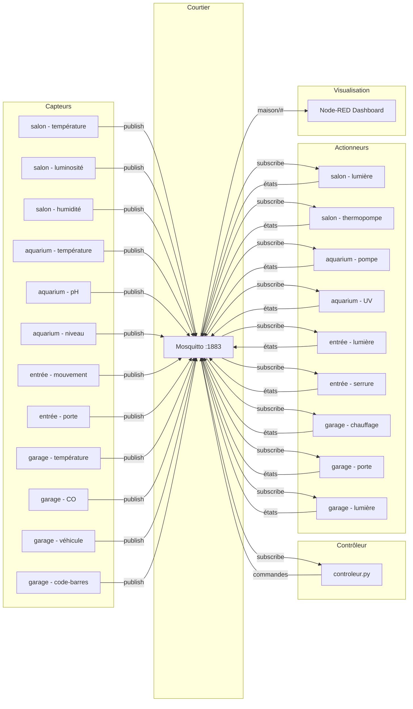

# Projet 1 — Maison intelligente simulée

Cours **420-315-AH — Développement d'objets intelligents**
Étudiante : **Laura Sorro**

Simulation d'une maison connectée avec 3 pièces (Salon, Entrée, Garage) et un aquarium, comprenant 12 capteurs, 9 actionneurs, un contrôleur à règles automatiques, et un tableau de bord Node-RED en temps réel.

---

## Architecture (flux publish-subscribe)



---

## Règles d'automatisation

Le contrôleur relie capteurs et actionneurs via les règles suivantes :

| # | Capteur déclencheur | Condition | Actionneur | Commande |
|---|---------------------|-----------|------------|----------|
| 1 | Luminosité salon | < 200 lux | Lumière salon | `allume` |
| 2 | Luminosité salon | ≥ 200 lux | Lumière salon | `eteint` |
| 3 | Température salon | < 18°C | Thermopompe salon | `chauffe` |
| 4 | Température salon | > 23°C | Thermopompe salon | `climatise` |
| 5 | Température salon | 18–23°C | Thermopompe salon | `arrete` |
| 6 | pH aquarium | < 6.8 ou > 7.5 | — | log surveillance |
| 7 | Niveau aquarium | < 70% | UV aquarium | `eteint` |
| 8 | Niveau aquarium | ≥ 70% | UV aquarium | `allume` |
| 9 | Mouvement entrée | détecté (1) | Lumière entrée | `allume` |
| 10 | Mouvement entrée | absent (0) | Lumière entrée | `eteint` |
| 11 | Température garage | < 15°C | Chauffage garage | `allume` |
| 12 | Température garage | ≥ 17°C | Chauffage garage | `eteint` |
| 13 | CO garage | > 25 ppm | Porte garage | `ouvre` |
| 14 | Véhicule + code-barres valide | AUTO-001/002/003 | Porte + lumière garage | `ouvre` / `allume` |
| 15 | Véhicule parti | absent (0) | Porte + lumière garage | `ferme` / `eteint` |

**Notes sur les seuils :**
- Température garage : 15°C minimum selon le Règlement 03-096 de la Ville de Montréal
- CO garage : 25 ppm selon le Ministère de la Sécurité publique du Québec
- pH aquarium : 6.8–7.5 selon les normes d'aquariophilie eau douce

---

## Structure

```
projet1-420-315-E26/
├── config.py                           Constantes : MQTT, sujets, tables
├── requirements.txt
├── flows.json                          Flux Node-RED exportés
├── capteurs/
│   ├── __init__.py
│   ├── base_capteur.py                 Classe de base Capteur (LWT, retain, QoS)
│   ├── capteur_salon_temperature.py
│   ├── capteur_salon_luminosite.py
│   ├── capteur_salon_humidite.py
│   ├── capteur_aquarium_temperature.py
│   ├── capteur_aquarium_ph.py          Capteur pH (ajouté par la prof)
│   ├── capteur_aquarium_niveau.py
│   ├── capteur_entree_mouvement.py
│   ├── capteur_entree_porte.py
│   ├── capteur_garage_temperature.py
│   ├── capteur_garage_co.py            Détection monoxyde de carbone
│   ├── capteur_garage_vehicule.py
│   ├── capteur_garage_barcode.py       Lecteur de code-barres simulé
│   └── exemples/
│       └── capteur_aquarium.py         Exemple fourni par la prof
├── actionneurs/
│   ├── __init__.py
│   ├── base_actionneur.py              Classe de base Actionneur (QoS 2, retain)
│   ├── actionneur_salon_lumiere.py
│   ├── actionneur_salon_thermopompe.py
│   ├── actionneur_aquarium_pompe.py
│   ├── actionneur_aquarium_uv.py
│   ├── actionneur_entree_lumiere.py
│   ├── actionneur_entree_serrure.py    Verrouillée par défaut
│   ├── actionneur_garage_chauffage.py
│   ├── actionneur_garage_porte.py
│   └── actionneur_garage_lumiere.py
└── controleur/
    ├── __init__.py
    └── controleur.py                   Contrôleur + règles d'automatisation
```

---

## Prérequis

- **Python 3.11+**
- **Mosquitto** (courtier MQTT) en écoute sur `localhost:1883`
- **Node-RED** + le module **@flowfuse/node-red-dashboard**

### Windows 10/11

**1. Mosquitto**
- Télécharger : https://mosquitto.org/download/
- Éditer `C:\Program Files\mosquitto\mosquitto.conf` :
```
  listener 1883 localhost
  allow_anonymous true
```
- Dans un terminal **administrateur** :
```powershell
  net stop mosquitto
  net start mosquitto
```

**2. Node-RED**
- Installer **Node.js LTS** : https://nodejs.org/
```powershell
  npm install -g node-red
  node-red
```

**3. Dépendances Python**
```powershell
py -m pip install paho-mqtt
```

---

## Exécution

> Lancer chaque commande dans un terminal séparé, depuis le dossier `projet1-420-315-E26/`.

```powershell
# Terminal 1 — Contrôleur
py -m controleur.controleur

# Capteurs (un terminal par capteur)
py -m capteurs.capteur_salon_temperature
py -m capteurs.capteur_salon_luminosite
py -m capteurs.capteur_salon_humidite
py -m capteurs.capteur_aquarium_temperature
py -m capteurs.capteur_aquarium_ph
py -m capteurs.capteur_aquarium_niveau
py -m capteurs.capteur_entree_mouvement
py -m capteurs.capteur_entree_porte
py -m capteurs.capteur_garage_temperature
py -m capteurs.capteur_garage_co
py -m capteurs.capteur_garage_vehicule
py -m capteurs.capteur_garage_barcode

# Actionneurs (un terminal par actionneur)
py -m actionneurs.actionneur_salon_lumiere
py -m actionneurs.actionneur_salon_thermopompe
py -m actionneurs.actionneur_aquarium_pompe
py -m actionneurs.actionneur_aquarium_uv
py -m actionneurs.actionneur_entree_lumiere
py -m actionneurs.actionneur_entree_serrure
py -m actionneurs.actionneur_garage_chauffage
py -m actionneurs.actionneur_garage_porte
py -m actionneurs.actionneur_garage_lumiere
```

### Tableau de bord Node-RED

1. Lancer Node-RED : `node-red`
2. Ouvrir http://localhost:1880
3. Importer `flows.json` : menu ☰ → **Import** → sélectionner `flows.json`
4. Cliquer **Deploy**
5. Tableau de bord : http://localhost:1880/dashboard

---

## Sujets MQTT

### Capteurs (publish)

| Sujet | Charge utile | Description |
|-------|-------------|-------------|
| `maison/salon/temperature` | `{"type","valeur","unite","horodatage"}` | Température salon (°C) |
| `maison/salon/luminosite` | `{"type","valeur","unite","horodatage"}` | Luminosité salon (lux) |
| `maison/salon/humidite` | `{"type","valeur","unite","horodatage"}` | Humidité salon (%) |
| `maison/salon/aquarium/temperature` | `{"type","valeur","unite","horodatage"}` | Température aquarium (°C) |
| `maison/salon/aquarium/ph` | `{"type","valeur","unite","horodatage"}` | pH aquarium (6.8–7.5 normal) |
| `maison/salon/aquarium/niveau` | `{"type","valeur","unite","horodatage"}` | Niveau eau aquarium (%) |
| `maison/entree/mouvement` | `{"type","valeur","unite","horodatage"}` | Mouvement entrée (0/1) |
| `maison/entree/porte` | `{"type","valeur","unite","horodatage"}` | État porte entrée (ouvert/ferme) |
| `maison/garage/temperature` | `{"type","valeur","unite","horodatage"}` | Température garage (°C) |
| `maison/garage/co` | `{"type","valeur","unite","horodatage"}` | CO garage (ppm) |
| `maison/garage/vehicule` | `{"type","valeur","unite","horodatage"}` | Présence véhicule (0/1) |
| `maison/garage/barcode` | `{"type","valeur","unite","horodatage"}` | Code-barres lu (AUTO-001/002/003/INCONNU) |

### Actionneurs (commande / état)

| Sujet commande | Sujet état | Commandes |
|----------------|------------|-----------|
| `maison/salon/lumiere/cmd` | `maison/salon/lumiere/etat` | `allume` / `eteint` |
| `maison/salon/thermopompe/cmd` | `maison/salon/thermopompe/etat` | `chauffe` / `climatise` / `ventile` / `arrete` |
| `maison/salon/aquarium/pompe/cmd` | `maison/salon/aquarium/pompe/etat` | `allume` / `eteint` |
| `maison/salon/aquarium/uv/cmd` | `maison/salon/aquarium/uv/etat` | `allume` / `eteint` |
| `maison/entree/lumiere/cmd` | `maison/entree/lumiere/etat` | `allume` / `eteint` |
| `maison/entree/serrure/cmd` | `maison/entree/serrure/etat` | `verrouille` / `deverrouille` |
| `maison/garage/chauffage/cmd` | `maison/garage/chauffage/etat` | `allume` / `eteint` |
| `maison/garage/porte/cmd` | `maison/garage/porte/etat` | `ouvre` / `ferme` |
| `maison/garage/lumiere/cmd` | `maison/garage/lumiere/etat` | `allume` / `eteint` |

### Santé des capteurs (LWT)

| Sujet | Charge utile | Description |
|-------|-------------|-------------|
| `maison/salon/temperature/sante` | `{"etat":"hors-ligne"}` | LWT capteur température salon |
| `maison/salon/luminosite/sante` | `{"etat":"hors-ligne"}` | LWT capteur luminosité salon |
| `maison/salon/humidite/sante` | `{"etat":"hors-ligne"}` | LWT capteur humidité salon |
| `maison/salon/aquarium/temperature/sante` | `{"etat":"hors-ligne"}` | LWT capteur température aquarium |
| `maison/salon/aquarium/ph/sante` | `{"etat":"hors-ligne"}` | LWT capteur pH aquarium |
| `maison/salon/aquarium/niveau/sante` | `{"etat":"hors-ligne"}` | LWT capteur niveau aquarium |
| `maison/entree/mouvement/sante` | `{"etat":"hors-ligne"}` | LWT capteur mouvement entrée |
| `maison/entree/porte/sante` | `{"etat":"hors-ligne"}` | LWT capteur porte entrée |
| `maison/garage/temperature/sante` | `{"etat":"hors-ligne"}` | LWT capteur température garage |
| `maison/garage/co/sante` | `{"etat":"hors-ligne"}` | LWT capteur CO garage |
| `maison/garage/vehicule/sante` | `{"etat":"hors-ligne"}` | LWT capteur véhicule garage |
| `maison/garage/barcode/sante` | `{"etat":"hors-ligne"}` | LWT capteur code-barres garage |

---

## Bonus

### #2 — Carte maison en temps réel (+5%)

Une deuxième page Node-RED affiche un plan de la maison en HTML/CSS. La couleur de la bordure change selon l'état : 🟢 normal, 🟡 attention (thermopompe active), 🔴 alerte (mouvement détecté). Les données proviennent d'un abonnement `maison/#` via un nœud `function` qui maintient l'état global en mémoire de flux.

### #4 — Robustesse MQTT (+5%)

- **QoS 0** pour les capteurs : publication fréquente (2s), une valeur perdue est sans conséquence
- **QoS 2** pour les abonnements des actionneurs : une commande doit être exécutée exactement une fois
- **retain=True** sur tous les sujets capteurs et états actionneurs : le dashboard affiche une valeur dès l'ouverture
- **LWT** sur chaque capteur : en cas de déconnexion brutale, le courtier publie automatiquement `{"etat":"hors-ligne"}` sur le sujet `/sante` du capteur

### Pourquoi les bonus #1 et #3 ont été retirés

**Bonus #1 — Capteur de vision OpenCV :** retiré car la bibliothèque OpenCV ne permettait pas d'afficher le flux vidéo dans le dashboard Node-RED. Sans visualisation de la vidéo, la valeur ajoutée par rapport à un capteur simulé était insuffisante pour la démo.

**Bonus #3 — Alertes et notifications :** retiré car les données étant simulées de façon aléatoire, les alertes se déclenchaient continuellement sans refléter une situation réelle. Le système d'alertes sera plus pertinent au Projet 2 avec des données réelles et une base de données.

---

*Projet réalisé dans le cadre du cours 420-315-AH — Collège Ahuntsic, session été 2026.*